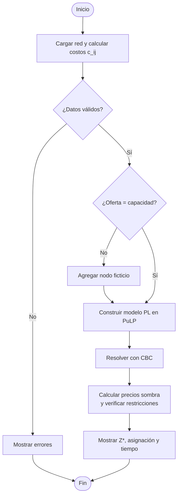

# EcoResiduos del Llano — Sistema de Optimización Logística

Proyecto final de **Optimización (2026-II)**, Programa de Ingeniería de Sistemas, **Universidad de los Llanos**.

Sistema web que minimiza el costo semanal de transportar residuos agropecuarios desde **10 agroempresas** hasta **4 plantas** (Villavicencio, Restrepo, Granada y Puerto Gaitán). Resuelve el problema con un **modelo exacto** de programación lineal (problema de transporte) y con un **algoritmo genético**, y además incluye **análisis de sensibilidad** y un **reporte comparativo** entre los dos métodos.

## Estado del proyecto

| Módulo | Estado | Observación |
|---|---|---|
| Red y parametrización | ✅ Listo | Carga, edición, validación y balanceo de la red |
| Modelo exacto | ✅ Listo | PuLP + CBC, precios sombra, verificación de restricciones |
| Algoritmo genético | ✅ Listo | Conectado a la API con `ejecutar(problema, parametros)`; selección por torneo o ruleta, cruce de uno o dos puntos |
| Análisis de sensibilidad | ✅ Listo | Rangos de la base óptima y simulación de escenarios |
| Reporte comparativo | ✅ Listo | Exacto vs. AG: costo, tiempo, gap y escalabilidad |
| Base de datos (Supabase) | ✅ Listo | Historial de escenarios y resultados |
| Informe IEEE | 🟡 En progreso | En `docs/informe-ieee/` |

Pruebas: **47 pasan y 6 se omiten** (las omitidas están pendientes de activar).

## Equipo y roles

| Rol | Integrante | Responsabilidad |
|---|---|---|
| 1. Líder de proyecto / Analista de negocio | Lucia Vega | Coordinación, informe IEEE, validación del modelo de negocio |
| 2. Ingeniero de modelado y optimización | Emmanuel Camacho | Formulación matemática y solver exacto |
| 3. Desarrollador de metaheurísticas | Astrid Martinez | Algoritmo genético |
| 4. Desarrollador de software e interfaz | Samuel Martinez | Arquitectura, interfaz, sensibilidad y reportes |

## Modelo matemático

- **Conjuntos:** agroempresas *i* ∈ I (fuentes) y plantas *j* ∈ J (destinos).
- **Parámetros:**
  - oferta *Oᵢ* (t/semana)
  - capacidad *Dⱼ* (t/semana)
  - costo unitario *cᵢⱼ* = distancia(*i*, *j*) × costo por km·ton + costo operativo de la planta *j*, en COP/t
- **Variable:** *xᵢⱼ* = toneladas por semana que van de *i* a *j*.
- **Función objetivo:** min Z = Σᵢ Σⱼ cᵢⱼ · xᵢⱼ
- **Restricciones:** oferta, capacidad y no negatividad.

Si la oferta total no es igual a la capacidad total, el sistema balancea la red con un nodo ficticio:

- una **agroempresa ficticia** con costo 0 si sobra capacidad;
- una **planta ficticia**, que representa el residuo no procesado, si falta capacidad.

Con el caso base el resultado es **Z\* = 132.532.000 COP/semana**, con la agroempresa ficticia E11 (oferta 1.540 t/sem, capacidad 1.700 t/sem, holgura de 160 t/sem en Puerto Gaitán).

## Algoritmo genético

- **Cromosoma:** matriz de flujos *X* (empresas × plantas) en toneladas/semana, trabajada sobre la **misma red balanceada** que usa el solver exacto (incluye el nodo ficticio). Así ambos métodos resuelven el mismo problema y el gap es comparable.
- **Factibilidad:** cada fila se reescala para sumar exactamente su oferta, y un operador de **reparación** mueve el exceso de las plantas saturadas hacia las que tienen holgura (las más baratas primero). La **penalización cuadrática** queda como respaldo.
- **Aptitud:** `fitness = 1 / (1 + Z)`, con Z = costo + penalizaciones. La selección compara Z directamente.
- **Operadores:** selección por torneo o ruleta, cruce de uno o dos puntos y mutación que traslada toneladas de una planta a otra dentro de la misma empresa (conserva la oferta).
- **Parámetros ajustables desde la interfaz:** población (100), generaciones (500), tasa de cruce (0,8), tasa de mutación (0,05), tipo de selección, tipo de cruce y semilla.
- **Calidad:** el gap se calcula como (Z_AG − Z_exacto) / Z_exacto × 100. Con los parámetros por defecto y semilla 1 el caso base da 134.370.550 COP/semana (gap ≈ 1,39 %).

## Arquitectura

```
Navegador (React + Vite)  ──HTTP/JSON──►  API REST (FastAPI, Python)  ──SQLAlchemy──►  PostgreSQL (Supabase)
   parametrización                          ├── services/red           (carga, validación, balance)
   resultados y gráficas                    ├── services/exacto        (PuLP + CBC, duales)
   sensibilidad y comparativo               ├── services/genetico      (AG propio)
                                            ├── services/sensibilidad  (rangos y escenarios)
                                            └── services/comparativo   (gap, tiempos, escalabilidad)
```

Sin base de datos, el sistema lee los escenarios de `backend/data/escenarios/*.json` (`FUENTE_DATOS=json`).

## Requerimientos no funcionales

- **Rendimiento:** el modelo exacto resuelve el caso base en menos de 1 segundo y el AG con parámetros por defecto en pocos segundos.
- **Usabilidad:** interfaz web con una página por módulo y mensajes de error claros ante datos inválidos.
- **Confiabilidad:** resultados reproducibles (el AG acepta semilla) y pruebas automáticas con pytest.
- **Portabilidad:** funciona en cualquier navegador moderno y en Windows, Linux o Mac (Python 3.11+, Node.js 18+).
- **Mantenibilidad:** código dividido en módulos independientes por responsabilidad.
- **Disponibilidad de datos:** puede funcionar sin base de datos, leyendo el caso base desde JSON.

## Estructura del repositorio

```
├── contexto/             Enunciado del proyecto
├── docs/                 Informe IEEE, diagramas, formulación y guía de la base de datos
├── supabase/             Scripts SQL (tablas, vistas, funciones y seguridad)
├── instalar_bd.py        Instalador de los archivos de la base de datos
├── backend/
│   ├── app/
│   │   ├── main.py       Punto de entrada de FastAPI
│   │   ├── core/         Configuración (.env)
│   │   ├── db/           Conexión y modelos ORM (SQLAlchemy)
│   │   ├── models/       Entidades del dominio (red, nodos, arcos)
│   │   ├── schemas/      Contratos de entrada y salida (Pydantic)
│   │   ├── api/routes/   Endpoints, uno por módulo
│   │   └── services/     Lógica: red, exacto, genetico, sensibilidad, comparativo
│   ├── data/escenarios/  dataConfig.json (caso base)
│   ├── scripts/          sembrar_bd.py (carga los JSON en la base de datos)
│   └── tests/            Pruebas con pytest
└── frontend/
    └── src/
        ├── api/          Cliente HTTP
        ├── pages/        Inicio, Parametrización, Exacto, Genético, Sensibilidad, Comparativo
        ├── components/   Matrices, grafo de la red, gráficas
        ├── context/      Estado global de la red
        └── utils/        Formato y exportación a CSV
```

## Cómo ejecutar

### Requisitos

- Python 3.11 o superior
- Node.js 18 o superior
- (Opcional) un proyecto en Supabase

### 1. Backend

```bash
cd backend
python -m venv .venv
# Windows: .venv\Scripts\activate   |   Linux/Mac: source .venv/bin/activate
pip install -r requirements.txt
cp .env.example .env        # en Windows: copy .env.example .env
uvicorn main:app --reload
```

- API: http://localhost:8000
- Documentación interactiva: http://localhost:8000/docs

> ⚠️ Use `pulp==2.9.0` (ya está fijado en `requirements.txt`). Con PuLP 3 o 4 el modelo exacto falla.

### 2. Frontend

```bash
cd frontend
npm install
npm run dev
```

Interfaz: http://localhost:5173

### 3. Base de datos (opcional)

1. En Supabase, abra **SQL Editor**, pegue `supabase/crear_base_datos_ecoresiduos.sql` y ejecútelo.
2. En `backend/.env` ponga `FUENTE_DATOS=bd`, `DATABASE_URL` (Session pooler) y `DATABASE_PASSWORD`.
3. Cargue el caso base:
   ```bash
   cd backend
   python -m scripts.sembrar_bd
   ```

Para más detalle, vea [docs/base-datos/GUIA_BASE_DATOS.md](docs/base-datos/GUIA_BASE_DATOS.md).

### 4. Pruebas

```bash
cd backend
pytest
```

`tests/test_exacto.py` usa el caso base como referencia: Z\*, los precios sombra y el nodo ficticio E11 deben coincidir con el informe.

## Endpoints principales

| Método | Ruta | Descripción |
|---|---|---|
| GET | `/red/escenarios` | Lista los escenarios disponibles |
| GET | `/red/escenarios/{nombre}/problema` | Red convertida a oferta, capacidad y costos |
| POST | `/red/validar` | Errores de datos y estado del balance |
| POST | `/exacto/resolver` | Modelo exacto: Z\*, asignación, duales, verificación |
| POST | `/genetico/resolver` | Algoritmo genético: mejor costo, asignación, tiempo, factibilidad e historial |
| POST | `/sensibilidad/rangos` | Rangos de costos, oferta y capacidad |
| POST | `/sensibilidad/simular` | Simulación de escenarios |
| POST | `/sensibilidad/escenarios-predefinidos` | Combustible ±, oferta ±, cuellos de botella |
| POST | `/comparativo/reporte` | Exacto vs. AG: costo, tiempo y gap |
| POST | `/comparativo/escalabilidad` | Redes de 10, 20, 50 y 100 agroempresas |
| GET/POST | `/escenarios` | Historial de escenarios *(requiere base de datos)* |
| GET/POST | `/resultados` | Historial de ejecuciones *(requiere base de datos)* |

## Diagramas

Están en `docs/diagramas/`:

- diagrama de clases;
- diagrama de flujo del modelo de transporte;
- diagrama de flujo del algoritmo genético;
- diagrama de secuencia del modelo exacto.


