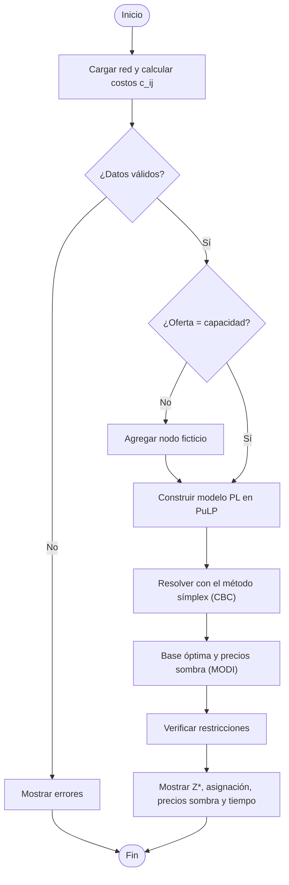

# Formulación del modelo de transporte

Versión completa en el informe IEEE (sección III, apartados B a F). Implementación en
`backend/app/services/exacto/`.

## Conjuntos
- I = {E01..E10}: agroempresas (fuentes)
- J = {P1..P4}: plantas (Villavicencio, Restrepo, Granada, Puerto Gaitán)

## Parámetros
- O_i: oferta semanal de la agroempresa i (t/sem)
- D_j: capacidad máxima de la planta j (t/sem)
- d_ij: distancia vial i→j (km)
- c_u: costo de transporte, 1200 COP/(km·t)
- c_j^op: costo operativo de la planta j (COP/t)
- c_ij = c_u · d_ij + c_j^op (COP/t)

Datos: `backend/data/escenarios/dataConfig.json`. Caso base: ΣO = 1540 < ΣD = 1700.

## Variable de decisión
- x_ij: toneladas semanales enviadas de la agroempresa i a la planta j
- 40 variables en el modelo original (10 × 4) y 44 en la forma balanceada (11 × 4)

## Modelo
min Z = Σ_i Σ_j c_ij x_ij
- Oferta: Σ_j x_ij = O_i  ∀i
- Capacidad: Σ_i x_ij ≤ D_j  ∀j
- x_ij ≥ 0

Las rutas deshabilitadas por el usuario se fijan en x_ij = 0.

## Forma balanceada (la que resuelve el software)
Si ΣO < ΣD se agrega la agroempresa ficticia E11 (oferta ΣD − ΣO, costo 0) y todas las
restricciones pasan a igualdad. Si ΣO > ΣD se agrega una planta ficticia (residuo sin procesar).
En el caso base, E11 tiene oferta 160 t/sem; su flujo representa la capacidad ociosa de las plantas.

## Método de solución
1. **Formulación:** el problema de transporte balanceado se escribe como programa lineal en PuLP
   (`modelo.py`: `balancear` y `construir_modelo`).
2. **Solución:** se resuelve con el **método símplex** mediante el solver **CBC** (`solver.py`).
   No se usa el algoritmo especializado del transporte (esquina noroeste o Vogel).
3. **Base y duales:** con la solución óptima se reconstruye la base del problema de transporte
   (n + m − 1 celdas básicas, que forman un árbol) y se calculan los precios sombra con el
   **método MODI** (u_i + v_j = c_ij en las celdas básicas) (`base.py`).
4. **Verificación:** costos reducidos c̄_ij = c_ij − u_i − v_j ≥ 0 (optimalidad) y cumplimiento de
   las restricciones de oferta, capacidad y no negatividad (`verificacion.py`).
5. **Sensibilidad:** con la misma base se obtienen los rangos de oferta, capacidad y costos que no
   cambian la base óptima (`services/sensibilidad/analisis.py`).

## Dual
max W = Σ_i O_i u_i + Σ_j D_j v_j
- u_i + v_j ≤ c_ij  ∀(i, j)
- u_i libre (oferta), v_j ≤ 0 (capacidad)

En el software el dual del nodo ficticio se fija en 0, así v_j = 0 en las plantas con capacidad ociosa.

## Resultado del caso base
- Z* = 132.532.000 COP/semana (≈ 97,6 M de transporte y 35,0 M de operación)
- P1, P2 y P3 al 100 %; P4 con 160 t/sem ociosas (flujo de E11)
- v = (−29.000; −11.600; −47.200; 0) COP/t
- u = (44.400; 154.800; 87.600; 94.800; 150.000; 121.200; 105.600; 156.000; 39.600; 79.200) COP/t
- Base no degenerada (14 variables básicas) con óptimos alternativos: E03→P1 y E08→P2 tienen
  costo reducido 0.

| Empresa | P1 | P2 | P3 | P4 | Enviado |
|---|---|---|---|---|---|
| E01 | 0 | 120 | 0 | 0 | 120 |
| E02 | 220 | 0 | 0 | 30 | 250 |
| E03 | 0 | 90 | 0 | 0 | 90 |
| E04 | 0 | 0 | 180 | 0 | 180 |
| E05 | 0 | 0 | 0 | 210 | 210 |
| E06 | 90 | 0 | 70 | 0 | 160 |
| E07 | 50 | 60 | 0 | 0 | 110 |
| E08 | 140 | 0 | 0 | 0 | 140 |
| E09 | 0 | 80 | 0 | 0 | 80 |
| E10 | 0 | 0 | 200 | 0 | 200 |
| **Recibido** | 500 | 350 | 450 | 240 | 1540 |

## Rangos sin cambiar la base óptima

| Planta | Capacidad | v_j (COP/t) | Mínimo | Máximo |
|---|---|---|---|---|
| P1 Villavicencio | 500 | −29.000 | 340 | 530 |
| P2 Restrepo | 350 | −11.600 | 290 | 380 |
| P3 Granada | 450 | −47.200 | 380 | 480 |
| P4 Puerto Gaitán | 400 | 0 | 240 | ∞ |

| Agroempresa | Oferta | u_i (COP/t) | Mínimo | Máximo |
|---|---|---|---|---|
| E01 | 120 | 44.400 | 90 | 180 |
| E02 | 250 | 154.800 | 220 | 410 |
| E03 | 90 | 87.600 | 60 | 150 |
| E04 | 180 | 94.800 | 150 | 250 |
| E05 | 210 | 150.000 | 0 | 370 |
| E06 | 160 | 121.200 | 130 | 320 |
| E07 | 110 | 105.600 | 80 | 270 |
| E08 | 140 | 156.000 | 110 | 300 |
| E09 | 80 | 39.600 | 50 | 140 |
| E10 | 200 | 79.200 | 170 | 270 |

Z*, los precios sombra y los óptimos alternativos los comprueba `backend/tests/test_exacto.py`; los rangos, `backend/tests/test_sensibilidad.py`.
